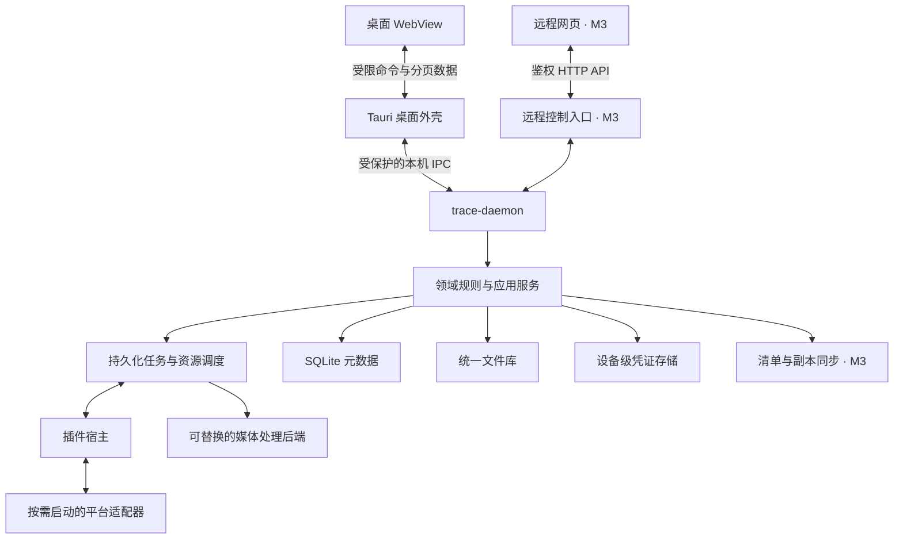
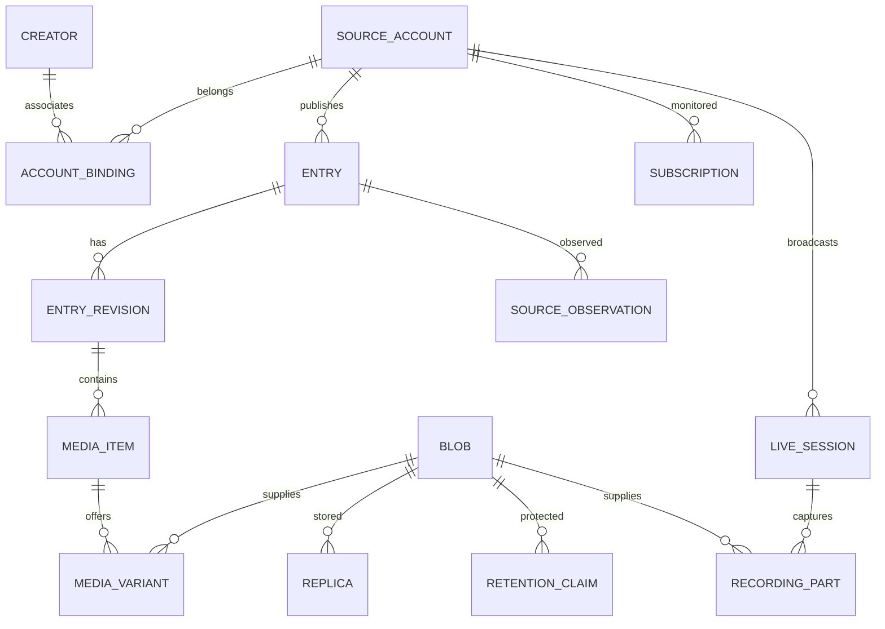
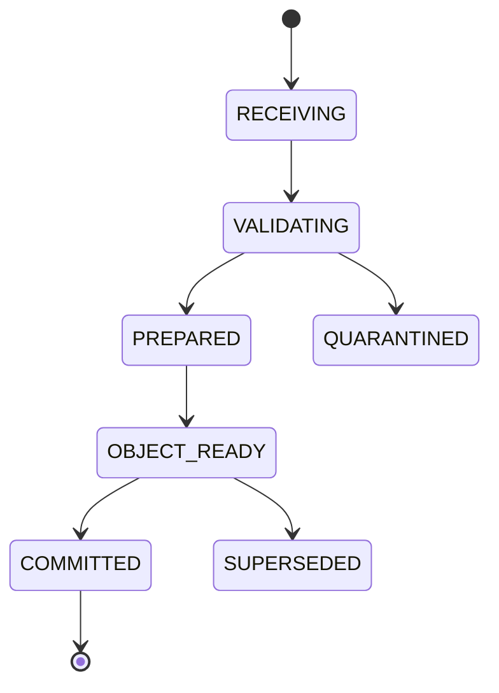
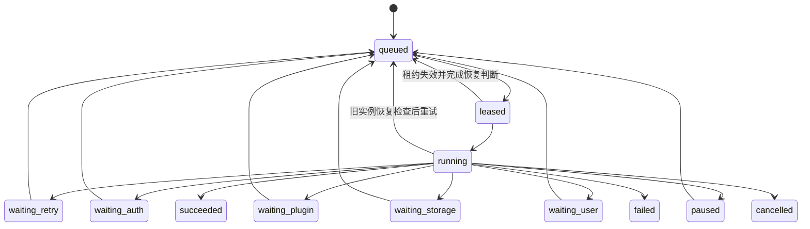
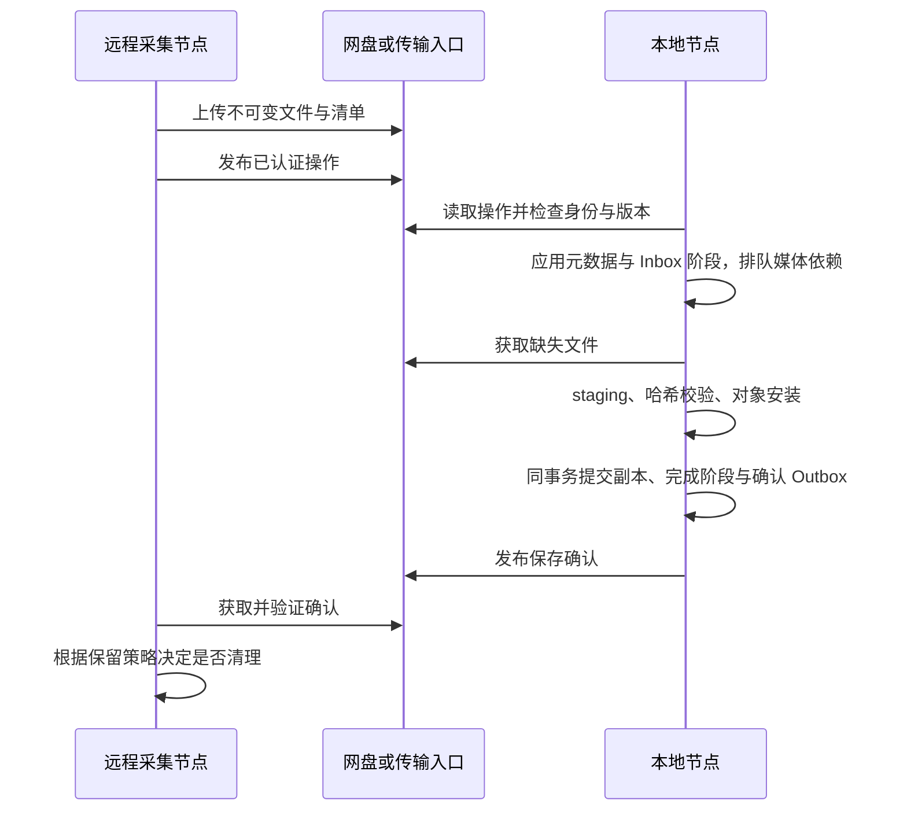

# TRACE 技术设计文档

> 版本：0.3 · 日期：2026-09-26 · 状态：架构与协议设计基线，尚未实现。
>
> 产品行为和验收要求以[需求文档](requirements.md)为准。本文明确系统边界、领域模型、持久化流程与失败处理；示例接口、目录和参数用于指导实现，不表示仓库已有对应代码。通用技术按[开源规则](dev-rules/open-source-first.md)查证与整合，站点获取按[网站规则](dev-rules/site-adapters.md)独立研究。阶段门槛见[路线](delivery/roadmap-and-acceptance.md)。

<a id="overview"></a>
## 1. 设计目标与约束

- 使用 Tauri 构建桌面外壳，Rust 实现无界面核心、后台与适配器协议。
- 使用 monorepo 管理共享模型和多个部署入口，保持可独立构建与测试的边界。
- 初始采用本地数据库和文件库，不引入常驻的外部数据库、消息队列或搜索服务。
- 所有网站、登录辅助、通知、外部存储与可选处理能力通过明确契约接入。
- 平台能力存在差异，规范化模型同时保留必要扩展与来源证据。
- 支持单用户、单档案写入服务；未来本地与 VPS 各持有自己的数据库。
- 允许推翻不合适的实现；任何设计变更都必须维护已有档案的迁移与恢复能力。

首轮 Windows 进程、IPC、凭证、播放/搜索和预算细化见[M1a 运行契约](design/m1a-runtime-contracts.md)，工作包及用例在[唯一计划](delivery/m0-m1a-execution-plan.md)。该子契约细化本设计，不重定义以下不变量。

<a id="invariants"></a>
## 2. 核心不变量

| 编号 | 不变量 | 主要验证 |
|---|---|---|
| INV-01 | 改名、身份合并与平台插件替换不改变来源账号、发布记录及文件的身份 | AC-01、AC-02 |
| INV-02 | 每份已确认的发布版本保留自身内容语义，新的观察不会原地覆盖旧版 | AC-04 |
| INV-03 | 完成状态只在所需资源、校验与引用提交满足条件时成立 | AC-03、AC-05、AC-19 |
| INV-04 | 相同字节可以共享实体，每条发布的语境和来源独立保留 | AC-02 |
| INV-05 | 文件回收必须检查保留引用、独有覆盖、进行中操作和副本策略 | AC-05～07、AC-21 |
| INV-06 | 没有 GUI 时，检查、下载、录制与告警仍由后台推进 | AC-09～10 |
| INV-07 | 停用或移除适配器不影响已有基础档案的解释与读取 | AC-11 |
| INV-08 | 对失败、权限不足、删除和未知覆盖分别建模，状态必须有证据 | AC-08、AC-13 |
| INV-09 | 任务与消息允许至少一次执行，业务效果依靠稳定身份和幂等提交约束 | AC-03、AC-20 |
| INV-10 | 凭证、短期签名访问地址不进入普通档案、日志、导出和同步 | AC-25 |
| INV-11 | 文件提交与数据库提交之间的每个中断窗口均有可重入恢复路径 | AC-05、AC-17～19 |
| INV-12 | 远端“已保存”确认必须基于接收方校验与归档提交；删除范围不可混淆 | AC-20～22 |

相似度、来源声称的“最高画质”和未校验的路径存在性都不构成删除或成功的充分证据。任一变更破坏上述不变量时，应先修正模型或协议，再调整实现。

<a id="architecture"></a>
## 3. 运行架构与进程生命周期

### 3.1 部署结构



本地和远程是同一核心的不同部署方式。图中的两个入口不要求同时对公网开放；本地默认仅提供受保护的本机通信。

桌面外壳负责窗口、托盘、系统交互与请求转发。后台负责全部任务状态、调度、数据库写入和文件提交。WebView 不直接操作数据库、凭证或任意磁盘路径。

Tauri 官方进程模型区分核心进程与 WebView；TRACE 在此基础上额外划分独立后台，以支持 GUI 退出和无界面部署。[Tauri 进程模型](https://v2.tauri.app/concept/process-model/)

### 3.2 后台启动与单实例

1. 桌面启动时解析当前档案配置和稳定的节点 ID。
2. 尝试连接该用户、该数据目录的本机服务端点。
3. 服务不存在时，由启动器启动独立后台，再等待有时限的就绪握手。
4. 后台获取操作系统级独占锁，打开数据库并验证模式版本，然后发布端点。
5. 并发启动竞争失败者退出或连接已有服务，不仅凭 PID 文件判断实例。
6. API 握手返回服务实例 ID、节点 ID、协议版本、数据库兼容状态和恢复进度。

Windows 优先验证带当前用户访问控制的命名管道；Unix 类环境使用带文件权限的 Unix domain socket。服务锁随进程退出释放，端点信息和锁文件本身不能替代锁的持有状态。

后台独立管理标准输入输出、日志及子进程，避免持有 GUI 关闭后失效的管道。打包可以使用 Tauri 外部二进制能力；打包与独立生命周期需分别验证，不能根据“sidecar”名称假设进程会持续存活。[Tauri 外部二进制文档](https://v2.tauri.app/develop/sidecar/)

### 3.3 关闭、暂停与退出

| 动作 | 调度 | 进行中的工作 | 界面与进程 |
|---|---|---|---|
| 关闭 GUI | 继续 | 继续下载、录制与告警 | 销毁 WebView、播放器、登录辅助窗口和界面订阅；后台保留 |
| 暂停全部采集 | 暂停新工作 | 下载到可恢复边界暂停，录制封口后停止 | 服务和查询保留；显示暂停原因 |
| 停用平台模块 | 暂停该模块对应的新工作 | 该模块相关任务安全收尾；其他平台继续 | 先 draining，再 disabled |
| 完全退出 | 停止接收新工作 | 检查点、封口、提交或保留待恢复记录 | 后台正常退出；普通关闭远端网页不触发此动作 |
| 服务异常退出 | 无法继续 | 由恢复扫描重新判断 | 下次启动恢复；中断区间明确记录 |

托盘可以由可选轻量外壳提供，不持有采集真相。GUI 重新连接时先取得状态快照，再订阅有限速的事件；不依赖离线期间保留所有进度推送。

默认关闭不改变用户的登录后自启动设置。“完全退出”表示结束当前运行，自动启动设置由另一个明确选项管理。

<a id="modules"></a>
## 4. 模块、仓库与依赖

### 4.1 逻辑边界

| 模块 | 责任 | 依赖约束 |
|---|---|---|
| domain | 身份、版本、质量、保留与状态规则 | 不依赖 Tauri、数据库驱动或平台实现 |
| application | 用例编排、仓储接口、提交流程 | 依赖 domain 与抽象能力 |
| protocol | 核心 API、插件消息、清单模型及版本协商 | 不依赖具体网站；敏感类型与可持久化类型分开 |
| runtime | 调度、重试、资源预算、服务生命周期 | 调用应用服务，不自行重写领域规则 |
| catalog | SQLite 持久化、事务、迁移、查询 | 写入由后台统一协调 |
| object-store | 临时文件、哈希、提交、副本与回收 | 接受核心生成的定位信息 |
| plugin-host | 启停、握手、能力授权、健康与消息边界 | 不授予任意数据库写权限 |
| media | 探测、流拷贝、分片封口、兼容性预览 | 使用类型化计划调用可替换后端 |
| credentials | 设备级保管、授权使用、验证与撤销 | 不随档案同步，界面只持有安全引用 |
| sync（M3） | 变更清单、副本传输、确认与删除传播 | 不复制正在运行的数据库作为同步协议 |

以下是目标布局示意。逻辑边界先在模块层落实，只有实际需要独立构建或发布时才拆成 crate，避免提前创建空包。

```text
trace/
  docs/
    README.md
    requirements.md
    design.md
  apps/
    desktop/             # 前端与 Tauri 外壳
    daemon/              # 独立 Rust 后台入口
    remote-web/          # M3 网页控制
  crates/
    domain/
    protocol/
    core/                # 初期可容纳 application/runtime 等模块
    catalog/
    object-store/
    plugin-host/
    media/
    credentials/
    sync/                # M3
  adapters/
    platforms/<id>/
    storage/<id>/        # M3
  tests/
    fixtures/
    integration/
```

### 4.2 依赖原则

- Cargo workspace 管理 Rust；前端按 DEC-009 使用 Vue + TypeScript，首轮采用 Naive UI/Vite/Pinia/Router，后台采用 Tokio/rusqlite。具体版本、比较、许可与实测边界只在[选型正本](research/2026-09-26-technology-stack.md)维护；完整产品集成尚未验证。
- 本地元数据选择 SQLite，利用事务和索引支持可靠任务与查询。
- HTTP/TLS、异步运行、序列化、哈希、系统凭证、数据库访问和测试优先整合适用的活跃开源能力；A 推荐前查证，B 补集成验证并锁版本。候选、已采用、已集成与已验收分别记录。
- 通用媒体探测与封装优先评估 FFmpeg/ffprobe 后端，封装在可替换接口内。媒体处理和平台解析分别实现。
- GUI 和工具链以外不要求常驻 Node.js、Python 或额外服务进程。
- 不在本文选定站点接口或下载器。各网站单独验证，通用下载器的基础支持不代表满足 TRACE 全部归档语义；开源问题与人工取舍集中进入[事项总表](decisions/open-questions.md)。

SQLite 同一数据库允许多个读事务，但同一时刻只允许一个写事务，因此采用核心协调短写事务的结构，避免后台工作分别长期占用写锁。[SQLite 事务文档](https://sqlite.org/lang_transaction.html)

<a id="domain"></a>
## 5. 领域模型与身份规则

### 5.1 主要关系



图示省略登录账号、任务、索引和同步表。平台身份由稳定 platform_id 定义，插件安装 ID 和插件版本不进入来源账号或内容身份。

### 5.2 实体与关键字段

| 实体 | 关键字段及约束 |
|---|---|
| Creator | 全局唯一 creator_id、显示名、别名、标签、状态、合并重定向；ID 不随改名改变 |
| SourceAccount | account_id、source_namespace、native_account_key；后两者联合唯一；昵称与主页为可变资料 |
| AccountBinding | creator_id、account_id、有效关联与操作记录；默认一个账号一个有效创作者关联 |
| Entry | entry_id、source_namespace、native_kind、native_entry_key、来源账号、发现时间、生命周期版本；来源三元组唯一 |
| EntryRevision | revision_id、entry_id、语义摘要、规范化正文、来源版本证据、已观察时间；内容载荷不可变 |
| SourceObservation | 观察身份、entry/revision、访问状态、来源时间与证据、采集节点；用于表示重现、删除和可见性变化 |
| MediaItem | media_id、revision_id、语义角色、顺序、来源附件身份、比较分组；封面、正文图、正片和字幕角色不同 |
| MediaVariant | variant_id、media_id、来源表示标识、blob_id、声称规格、实测规格、身份与覆盖证据；保存已取得的变体 |
| Blob | blob_id、sha256、字节数、MIME、结构校验结果；字节身份独立于来源与存储路径 |
| Replica | blob_id、node_id、store_id、定位符、managed、可用状态、校验时间；同一 Blob 可有多个位置 |
| RetentionClaim | blob_id、位置范围、原因、拥有者、到期时间与版本；明确哪些字节仍须物理保留 |
| AssetSelection | media_id、质量策略版本、选定 variant_id、理由及是否人工固定；允许存在不可比较集合 |
| Subscription | account_id、范围、内容类型、登录引用、质量策略、配置版本、执行节点与生效状态 |
| ScanCheckpoint | subscription_id、扫描类型、范围、游标、观察窗口、覆盖证据与版本 |
| Job / Attempt | 逻辑工作身份、状态、目标、代次、重试条件；每次执行另记 attempt |
| LiveSession / RecordingPart | 来源场次身份、边界证据、捕获区间、序列、Blob、规格、连续性与缺口 |
| CredentialBinding | 平台、登录主体、设备安全存储引用、能力检查结果；不含可直接同步的秘密 |
| Outbox / Inbox | 提交后要投递的变更、已应用操作身份与顺序，用于索引、清单及 M3 同步 |
| DeletionRecord | 对象身份、作用范围、对象代次、权威版本、操作原因；防止旧操作复活档案 |

source_namespace 由平台与必要的站点实例身份组成；来源 ID 如果仅在账号、租户或实例内唯一，native key 必须包含完整作用域。实例定位地址与身份别名可以变化，不能把局部数字 ID 当成全平台全局身份。

内部 ID 使用无业务含义、可跨节点生成的标识；具体 UUID 实现与格式在协议 0.x 中锁定。内部 ID 与来源唯一键分别保存，跨节点归并规则见第 16.2 节。Blob 对外身份采用算法名称与完整哈希，传输时同时校验长度。

### 5.3 内容版本、观察与来源扩展

- EntryRevision 代表观察到的内容语义。正文、附件身份或资源顺序变化生成新版本。
- 计数器、临时访问 URL、抓取时间和点赞数不进入默认语义摘要；按需保存为观察属性。
- 相同语义复用已存在版本，但 A → B → A 的重现应记录新的观察顺序，不能丢失回退事实。
- 连续相同观察允许合并首次/末次观察时间和次数，控制增长；变化和扫描覆盖边界须保留。
- 有可信来源版本号时使用来源证据；没有时记录“观察顺序”，不将抓取时间伪装成作者编辑时间。
- 多节点观察没有可信来源全序时保留各自证据，不依设备时间戳覆盖“当前版本”；可由负责采集的节点重新观察确认，在此之前展示多个已观察版本或待确认状态。
- 来源删除或权限变化创建观察状态，不物理删除既有版本。
- 保存规范化内容块与经过清理的来源扩展，标记扩展 schema 版本；未知块至少提供安全文本、媒体引用或原始数据查看。
- 插件输出的 short-lived fetch 信息与可归档 source 信息使用不同类型；长期来源链接必须剥离凭证。
- 跨平台作品关联作为独立关系保存，并记录人工确认、哈希一致或相似候选等证据。

### 5.4 状态正交化

不使用一个字段混合“已下载、低清、登录失败、来源删除”等不同概念。

| 维度 | 示例值 | 判断依据 |
|---|---|---|
| 来源可访问性 | visible / restricted / unavailable / deleted_confirmed / unknown | 最近有效来源观察 |
| 资源保存程度 | undiscovered / pending / partial / complete / unknown | 本次版本所选资源清单与有效副本 |
| 质量满足情况 | unknown / meets_target / below_target / incomparable / pinned | 质量规则及人工选择 |
| 执行情况 | queued / running / waiting / succeeded / failed / cancelled | 具体 Job 的状态 |
| 副本可用性 | absent / transferring / staged / verified / offline / corrupt / retired | 节点与存储检查 |
| 历史覆盖 | not_scanned / scanning / bounded_complete / unknown | 扫描边界与来源能力 |

例如，一条视频可以同时为 visible、complete、below_target，且升级任务处于 waiting_auth。来源已删除但本地副本 verified 的内容仍可完整浏览。

### 5.5 时间模型

发布时间、来源修改时间、首次发现时间、归档时间、录制时间分别保存，统一使用 UTC 时间值并记录来源时区或原始表达（可获取时）。

调度等待和本进程耗时使用单调时钟。跨节点同步顺序使用操作序号与版本，不能依赖设备墙上时钟。未知发布时间保持为空，界面可明确切换到发现时间排序。

视频 PTS、片段序号和实际捕获时间分开保存。来源时间戳跳变会产生不连续标记；估计的直播缺口应携带精度信息。


<a id="storage"></a>
## 6. 持久化、文件提交与恢复

### 6.1 存储布局

运行状态与大文件分开。数据库必须位于本机支持可靠锁与持久化语义的文件系统；媒体库可以使用另一个受支持的本地卷。网络或网盘通过存储适配器接入，不能让多个节点共享写入同一个 SQLite 文件。

```text
<data-root>/
  state/catalog.sqlite3
  state/migrations/
  state/backups/
  plugins/<plugin-id>/<version>/
  cache/thumbnails/
  cache/previews/
  logs/

<archive-root>/
  objects/sha256/<前两位>/<完整哈希>
  manifests/<entry-id>/<revision-id>/<manifest-hash>.json
  .staging/<operation-id>/
  .trash/<gc-operation-id>/
```

文件对象路径只由核心和哈希决定。媒体类型、平台、创作者与文件后缀是元数据属性，同类文件采用相同存储规则。导出时再生成可读目录与后缀。

.staging 与 objects 必须位于同一卷，才能使用该文件系统支持的同卷改名语义。跨卷复制通过独立迁移操作完成，不能假设跨卷移动具有原子性。

SQLite WAL 依赖同机进程共享机制，官方明确不支持通过网络文件系统实现跨主机访问。[SQLite WAL 文档](https://sqlite.org/wal.html)

### 6.2 数据库写入与约束

- 后台统一协调写事务，查询使用受控读连接；设置外键约束和适当的忙等待。
- 网络调用、媒体探测、哈希和大文件复制都在数据库写事务之外执行。
- 首轮采用 WAL 与 FULL 同步策略作为持久化基线，具体文件系统和性能在 M0 验证；不能仅凭配置声称抵抗所有硬件断电损坏。
- 来源唯一键、逻辑 Job 键、Blob 哈希、已应用操作 ID 和配置版本由数据库约束保护。
- 每次变更在同一事务中更新领域状态与 Outbox，再由后台处理索引、清单和通知。
- 搜索索引与 JSON 清单允许短暂延迟，可由核心状态重建；数据库是运行元数据权威。
- 数据库 schema、内容 schema、插件协议和同步协议分别标记版本。

### 6.3 文件提交状态

文件系统与 SQLite 不共享单一事务。Materialization 操作日志至少包含 operation_id、目标业务身份与代次、临时位置、预期来源证据、实际哈希与大小、最终位置、校验状态和当前阶段。



等待网络、存储或重试属于 Job 的执行状态；文件操作保留最后确认的阶段，由恢复矩阵决定下一步，不因等待而丢失已经完成的提交进度。

1. **登记接收。** 短事务创建操作日志与执行尝试。核心生成临时路径并预留预算；任务只保存可重新解析的来源身份。
2. **传输与检查点。** 流式写入并计算哈希；已提交的恢复偏移不得超过已经可靠落盘的字节。分块身份或来源校验器用于确认续传对象未变化。
3. **校验。** 结束后检查来源提供的长度或校验值、文件长度、媒体结构和可获得的覆盖证据。未知时长与未知资源清单保持未知。探测成功本身不证明整场直播完整。
4. **PREPARED。** 刷新文件到存储，持久化完整哈希、大小、临时和最终位置。最终对象为此操作预留，回收器不得处理它。
5. **OBJECT_READY。** 同卷安装不可变对象，禁止覆盖一个未验证的现有对象。目标已存在时验证其身份后复用；损坏对象进入单独修复流程。按操作系统能力同步相关目录或等价持久化边界。
6. **业务提交。** 短事务重检内容代次、取消状态、质量策略和已有选择；建立 Blob、Replica、媒体变体及保留引用，更新 Job，写入 Outbox，标记 COMMITTED。
7. **收尾。** 可重试地生成清单、更新索引、发送事件和清理临时残留。成功归档不等待界面在线。

如果用户在下载期间删除了档案，业务提交时识别代次失效，标记 SUPERSEDED，不复活 Entry。可用对象进入带等待期的未引用对象处理。若仅质量偏好变化，重新评价选择，不能由较晚完成的低质量任务覆盖已经选定的高质量版本。

### 6.4 崩溃恢复矩阵

| 中断位置 | 恢复判断与动作 |
|---|---|
| 日志已创建，临时文件不存在 | 重建接收或重新解析来源；不认为已有字节 |
| 临时文件存在，记录偏移较小 | 仅信任持久化检查点；验证后复用或截断到安全边界 |
| 接收完成但未 PREPARED | 重新校验并计算身份，不能直接登记成功 |
| PREPARED，文件仍在临时位置 | 校验并重新安装对象 |
| PREPARED，最终位置已有匹配对象 | 重入后续提交；唯一键消除重复效果 |
| OBJECT_READY，数据库业务未提交 | 重新检查目标代次及策略，完成提交或转为未引用对象 |
| COMMITTED，临时文件尚未清理 | 清理可证明属于该操作的残留，不撤销成功档案 |
| 数据库声称 verified，但对象缺失或损坏 | 将该副本降为 absent/corrupt，计算内容可用性并安排恢复 |
| 导出清单或搜索更新未完成 | 重放 Outbox；不再次下载已经有效的对象 |

启动先恢复核心可访问性，将大文件检查作为有预算的任务执行。孤立文件先隔离并记录，不在启动时全盘无差别删除。

### 6.5 归档清单

每个已归档内容版本有核心生成的版本化清单快照。快照以自身哈希形成不可变文件；补齐媒体或升级变体时生成新快照，数据库记录当前索引，不覆盖旧快照。清单至少包括：

- 档案、Entry 与 Revision 身份，来源平台、账号、永久链接及时间证据。
- 规范化正文、资源角色、顺序、来源关系及经过清理的扩展。
- 媒体变体、Blob 哈希与长度、已知规格、覆盖与质量判断。
- 清单 schema、内容语义摘要和生成依据的核心变更序号。

清单不包含本机绝对凭证路径、Cookie、Authorization、临时签名 URL 或可直接重放的认证数据。文件状态和保留选择可另由带版本的索引清单表达，避免修改已确认的内容事实。

清单与媒体可恢复基本来源档案。恢复订阅配置、标签、身份修改和任务历史还需要元数据备份，不能宣称仅凭媒体文件恢复所有应用状态。

<a id="quality"></a>
## 7. 质量、引用与回收

### 7.1 可比较性优先

质量判断分成两个步骤：

1. 判断是否为同一内容版本中的同一媒体，且剪辑、音轨要求、覆盖、画面比例及其他必要信息符合比较条件。
2. 在可比较集合中应用用户偏好，产生选择或明确的平局状态。

分辨率、帧率、动态范围、位深、来源等级、压缩方式、音轨和完整性共同构成描述。来源标签保留为声称值，实际探测结果单独保存。跨编码的码率不直接比较为质量高低。

质量函数返回四类结果：better、worse、equivalent、incomparable，并附证据与策略版本。未知数据不足以证明 better。人工固定的版本产生独立保留引用。

质量判断说明的是来源证据和可测规格下的策略结果，不保证主观观感。用户可以固定保留或修正选择，系统保留当时的比较理由。

直播比较还需要区间覆盖。新版本只有覆盖旧版全部应保留区间且其他要求满足时，才可以完全替换；否则保留独有区间或保留原片段，直到能证明安全整理。

### 7.2 选择与升级事务

- 可获取候选先以临时计划存在，成功取得的字节才成为持久化媒体变体。
- 每个媒体项依据当前策略维护一个最佳选择或不可比较集合。
- 下载前检查已有选择；完成后再次检查，防止任务乱序导致质量倒退。
- 同一事务内更新选择、创建新保留引用，并将旧选择引用转为等待回收。
- 旧变体的来源、规格和历史记录继续存在；历史元数据引用不等于必须保留物理副本。
- 另一发布记录仍选择同一 Blob、人工固定、导出进行中或副本策略要求保留时，仍有有效 RetentionClaim，不能回收。
- 默认归档每个已观察版本各自需要的最佳媒体；不同内容版本的历史不因“最高画质”规则被合并删除。

### 7.3 回收流程

1. 计算无有效保留引用、等待期结束、没有活动读取或写入操作的托管副本。
2. 在短事务中登记 GC 操作、位置与引用版本，将目标置为 retiring；后续新引用必须看到此状态并取消回收或等待重新获取。
3. 使用每对象操作锁协调移动、恢复、读取租约和新引用，避免“检查完无引用后又新增引用”的竞态。
4. 将对象移动到同卷 .trash，记录新位置；再次核对条件后删除，最后更新副本记录。
5. 每一步允许重入。中断后根据日志与两个已知位置恢复，不能因目录名推断可删。
6. unmanaged 副本、活动下载、未确认同步保护和其他内容所需文件均不进入自动回收。

复制到其他节点后，也要根据策略判断是否允许释放当前唯一受保护副本。自动清理不能替用户删除最后一份仍要求保留的档案；用户明确删除档案时，先处理其作用范围、引用和删除记录。

路径由核心生成并检查实际归属，拒绝目录穿越与越过存储根的链接。来源文件名仅作展示或经过处理的导出名称。

<a id="plugins"></a>
## 8. 插件契约与平台接入

### 8.1 插件类型与能力

平台适配器负责解析身份、枚举内容、提供来源状态与访问计划。调度、质量决策、归档目录和引用回收由核心控制。

| 平台能力 | 语义 |
|---|---|
| identity.resolve | 将主页、名称或来源标识解析为平台稳定身份，并说明证据 |
| profile.observe | 返回资料观察，区分事实与未知字段 |
| content.enumerate | 有界分页；声明历史/增量范围、游标及覆盖语义 |
| content.observe | 获取指定内容的当前版本与访问状态 |
| media.list_candidates | 返回来源媒体表示、规格与必要比较证据 |
| media.resolve | 将稳定媒体身份解析为短期访问计划 |
| live.check | 返回开播、未开播或未知，以及场次边界证据 |
| live.resolve | 返回录制访问计划及续期条件 |
| auth.begin / auth.validate | 启动已支持的登录辅助，检查具体能力 |
| state.migrate | 迁移适配器自己的非敏感检查点或配置 |

声明包括平台标识、版本、支持系统、协议范围、能力及限制、配置 schema、网络范围、错误模型、分页和速率提示。内容类型和可选字段按能力描述，不能要求每个平台实现相同功能。

通知、凭证辅助、存储和内容处理使用各自小契约，可复用同一宿主。第三方处理产物标明为派生内容，不修改原始归档。

### 8.2 进程与协议边界

采用可独立发布的 Rust 可执行适配器，通过版本化消息协议通信。M0/M1 以 0.x 协议验证，至少经过两种结构明显不同的来源后再承诺稳定主版本。

- 一个工作进程可服务同一插件的多个账号，不能按创作者常驻一个进程。
- 受限并发池按活动工作启动，空闲退出，正在处理的调用有截止时间与取消能力。
- 控制消息采用带长度边界的 UTF-8 JSON 帧，包含协议版本、请求 ID、方法、截止时间、能力上下文和结构化结果。
- stdout 或专用管道仅承载协议，诊断走独立通道且经过敏感清理。
- 协议 0.x 初始限制单帧 1 MiB、单页 100 条；更大内容以有界分块或核心管理的流处理，数值在 M0 验证。
- 大媒体字节通过单独的有界流接口或核心传输引擎处理，不能编码成无限增长的 JSON。
- 插件不能提交任意 shell 命令、最终文件路径或原始数据库语句。
- 宿主版本、插件版本、内容 schema 与游标状态版本分别协商；不兼容时拒绝新执行，已有档案照常读取。

Tauri 插件服务桌面生命周期与原生能力；这里定义的 TRACE 插件协议保持独立，以便同一适配器用于无 GUI 环境。[Tauri 插件文档](https://v2.tauri.app/develop/plugins/)

### 8.3 访问计划与凭证边界

Resolve 结果包含候选身份、允许的传输类型、有效期、来源校验器和续期条件。短期 URL、Cookie 和认证头仅在内存中的敏感计划内存在；任务持久化保留稳定身份，重启后重新解析。

核心优先提供受限 HTTP 与凭证使用代理。需要平台特定认证计算时，只提供被授权登录主体的必要短期能力或字段，不能提供整个凭证库。代理校验目标和重定向范围，流量计入对应预算。

特殊传输通过类型化的扩展传输源接入，核心接收有界字节流并负责最终存储，避免平台插件各自拥有独立文件库。

进程边界提供故障隔离。M1 只运行受信任适配器；能力协议本身不能阻止恶意本地可执行文件直接访问系统。开放第三方插件前，需要实现和验证操作系统级文件、网络、凭证与进程权限约束。

### 8.4 启停、更新与失败

```text
installed → starting → ready → draining → disabled
                 ↘ incompatible
                 ↘ degraded → backoff → starting
```

停用先阻止新派发，再通知相关 Job 到可恢复边界暂停；录制封口后停止。draining 期间仅允许已登记工作的收尾调用。超时终止进程后，相关工作进入恢复判断，不直接标记为永久失败。

升级采用并排版本目录、兼容性验证、停止旧版本新调用、收尾或转移任务、切换活动版本。核心数据库迁移不由插件执行。适配器状态迁移失败时保留旧状态副本；仅当状态兼容时允许直接回退。

错误至少区分 transient_network、rate_limited、auth_required、permission_denied、capability_lost、source_unavailable、source_deleted_confirmed、unsupported、schema_changed、invalid_payload、plugin_crash。错误携带可重试性与建议等待信息，但最终重试政策由核心决定。

### 8.5 实际网站研究的入口

首批视频目标为抖音、哔哩哔哩，按[站点适配规则](dev-rules/site-adapters.md)单独制定方案，不预选通用下载器。每个平台开始实现时，记录身份稳定性、内容种类、分页覆盖、编辑与删除信号、媒体有效期、登录权限、直播边界、请求预算及验证样本。实现仅绑定当时验证的能力和版本，不能把未知平台行为补成“完整成功”。

平台集成测试使用脱敏固定样本与显式授权的受控实时测试。模拟适配器持续覆盖协议和故障行为，不取代实际网站验证。


<a id="scheduler"></a>
## 9. 订阅、调度与任务执行

### 9.1 扫描与发现事务

扫描由“范围、游标、复查窗口、覆盖证据”组成，增量、历史回填和手动补查分别维护进度。

每个来源分页按以下顺序处理：

1. 校验消息、来源身份、分页上限及内容摘要是否完整。
2. 在短事务中 upsert 来源账号和 Entry，保存足够的发现信息，创建或复用详细获取、归档等逻辑任务。
3. 在同一事务中提交这一页对应的新游标和覆盖观察。
4. 事务成功后才请求下一页；发生失败时允许重复取得该页。

仅包含标题或摘要的分页结果保存为待补全发现，不能覆盖已经保存的完整 Revision。详细观察声明正文及媒体清单完整性，之后才建立相应已观察版本。

扫描游标是优化工具，来源稳定 ID 与版本身份承担去重职责。近期重扫和周期补查独立于最新发布时间，并受已选择范围及既有档案约束，不自动扩大收录范围；来源无法枚举全部历史时保留 unknown 覆盖。

### 9.2 Job 与 Attempt

Job 表示逻辑目标，Attempt 表示某次执行。失败重试复用 Job，记录新的 Attempt。逻辑目标至少包含工作类型、主体身份、内容或副本代次、策略版本。

| 工作 | 去重与触发原则 |
|---|---|
| 周期检查 | 每个订阅和扫描范围最多一个活动检查；持久化 trigger_id 防止同一次触发重复入队 |
| 详细观察 | 同一 Entry 和观察目标合并工作，允许后续新触发发现编辑 |
| 媒体获取 | 按媒体项、内容代次和质量目标合并；重启不生成新的逻辑目标 |
| 缺失副本恢复 | 使用独立恢复代次，避免旧的 succeeded 下载阻止重新获取 |
| 直播录制 | 同节点、同已识别场次和流角色最多一个活动录制 |
| 索引与清单 | 按对象版本和派生格式版本幂等生成 |
| 同步 | 按操作 ID、Blob 身份、目的节点和副本代次消除重复效果 |

状态包括 queued、leased、running、waiting_retry、waiting_auth、waiting_plugin、waiting_storage、waiting_user、paused、succeeded、failed、cancelled。



Attempt 记录 owner_instance_id、租约、尝试次数、错误分类与输出日志引用。服务启动后识别旧实例的工作，先检查副作用再回队列，不能一律视为从未执行。

取消通过可恢复边界完成。用户重试终态工作应创建显式重试事件或新目标代次，保留原有执行历史。

### 9.3 优先级与预算

| 优先级 | 工作 |
|---|---|
| P0 | 正在录制的传输、封口、必要流续期与恢复 |
| P1 | 开播检测、普通增量检查、已发现的新内容、影响活动采集的凭证验证 |
| P2 | 历史回填、失败补查、画质升级、本地文件导入 |
| P3 | 缩略图、兼容性预览、相似度分析、全库校验及可延迟维护 |

优先级配合全局、平台、登录账号、主机和任务类型预算；同级工作按账号公平调度。预留维护机会时不得破坏活动录制需要的最低带宽和写入能力。

来源推送是触发信号，仍需通过去重与发现事务。轮询带抖动，HTTP 调用、分页和续期请求均计入相应预算。真实预算由具体适配器调研确定，用户配置不能绕过已确认的平台限制。

瞬时网络错误采用有上限的指数退避与抖动；建议普通工作从 5 秒增长到 30 分钟。限流优先遵守有效等待指示；持续故障转入低频恢复并合并通知。直播的重连有单独的时效预算，凭证、插件和磁盘等待由对应状态变化唤醒，避免忙轮询。

### 9.4 下载与续传

- 每次尝试重新解析必要的短期访问计划，不从任务数据库重放过期 URL。
- 续传必须验证相同来源对象，例如可信版本身份、强校验器或稳定分块身份。
- 使用 HTTP Range 时校验响应码、Content-Range、偏移、总长度和对象校验器；服务器返回整文件或身份变化时重新开始，不能直接拼接。
- 只有弱校验器且无其他对象稳定证据时，默认重新获取。
- 完成的本地哈希用于字节身份；来源没有提供期望哈希时，它不能证明来源内容本身未缺失。
- 大文件采用有界流与背压，哈希可增量计算；恢复时重算所需前缀或依据验证过的分块身份重建状态。
- 校验与媒体探测复用已保存结果；修复操作先检查可用本地或远程副本，再尝试来源重下。

### 9.5 删除、策略变化与迟到结果

Job 记录对象 lifecycle_generation 和目标配置版本。提交时重新读取当前状态：已删除、被替代或执行权失效的结果可以保留为待处理文件证据，但不能改写当前有效状态。

质量策略变化不修改历史媒体事实；旧工作完成后按新策略评估。停订阅只阻止新调度和按设置暂停当前工作，不产生档案删除代次。

<a id="recording"></a>
## 10. 直播录制

### 10.1 场次与录制状态

```text
monitoring → starting → recording → finalizing → completed
                         ↓    ↑
                      reconnecting
                         ↓
                      interrupted
```

monitoring 属于订阅观察状态，LiveSession 在确认场次后创建，其采集状态从 starting 开始。manual_stop、plugin_disabled、auth_unavailable、storage_full、source_ended 和 process_crash 等结束原因独立于状态保存。

优先使用来源提供的场次 ID。没有稳定 ID 时，使用持久化本地场次身份、来源边界证据及观察历史判断是否续录；无法证明同一场次时新建并标记关联候选，避免误合并两场直播。

开始时保存确认开播时间、实际开始接收时间和最早有效媒体时间。结束需要来源或录制事实支持；单次超时不能直接判为正常结束。

### 10.2 分片与封口

- 初始目标片段时长约 15 秒，按容器、关键帧和来源分块边界调整；这不是对所有协议的严格丢失上限承诺。
- 每段通过第 6 节的提交流程独立落盘，已封口片段有 Blob、媒体规格和覆盖信息。
- 片段记录捕获时间、PTS、顺序、不连续标志、来源分段证据及必要误差范围。
- 发生崩溃时检查未封口尾段，允许修复、保留部分或隔离，不将其计为完整覆盖。
- 重启或重连建立新的捕获区间，不能盲目向可能损坏的容器追加字节。
- 一场直播通过片段清单表现为一个逻辑对象。连续播放或导出可以按需封装，不要求永久再保存一份相同质量的整场文件。
- 回放与直播录制的关联先比较内容与覆盖，剪辑回放不自动替代原录制。

原型需验证至少一种适合分段恢复的容器路径。关键验收是尾段损坏不影响已经封口的前段，且缺口有明确表示。

### 10.3 媒体后端

优先采用流拷贝和重新封装，只有用户请求预览兼容性或特定派生内容时才转码。FFmpeg 的 streamcopy 在兼容条件下不经过解码和编码，适合作为此能力的候选实现。[FFmpeg streamcopy](https://ffmpeg.org/ffmpeg.html#Streamcopy)

后端通过类型化参数与受控文件、管道工作，禁止从插件接收任意命令字符串。敏感 URL 和认证头不得暴露在命令行；优先由核心网络层获取媒体并提供受控输入，特殊协议需验证等价的凭证与流量控制边界。

所有子进程具有资源预算、取消机制和退出检查。清晰度下降保存为片段规格变化；不能因保存了较新高清片段，就删除仍覆盖独有时间的低清片段。

<a id="credentials"></a>
## 11. 凭证与能力验证

### 11.1 保存与使用

CredentialVault 以设备和登录主体为边界，数据库只保存引用、描述和非敏感验证结果。Windows 首先验证系统凭证设施，其他系统通过同一接口选择对应安全存储。不得自行设计密码算法。

登录辅助会话按需打开，结束或 GUI 关闭后释放。网页登录、Cookie 导入、OAuth 等具体方式由平台调研决定；HttpOnly 或浏览器隔离等限制不能通过假定“网页脚本总能读取”忽略。

核心发放与平台、登录账号和能力绑定的使用上下文，撤销账号后不再发放新上下文。对已开始的任务按策略安全暂停或切换，跨账号替换须检查权限语义。

### 11.2 能力矩阵

```text
登录账号
  session_access: valid | invalid | unknown
  original_image: allowed | denied | unknown
  video_quality: 已观察到的能力与范围
  membership_content: allowed | denied | unknown
  live_access: allowed | denied | unknown
  validated_at / evidence / retry_after
```

能力结果可能依赖内容、区域或其他来源限制，不能从单条内容推断全站所有资源都可访问。验证记录携带适用范围和证据。

临时访问 URL 过期先触发重新解析，不能立即宣告登录失效。认证失败、权益不足、来源不可见与网络错误分别分类。

### 11.3 降级、恢复与通知

1. 对照期望质量和当前访问能力，确定可保存版本。
2. “先保存”策略继续归档合法可访问版本，记录 below_target 和升级需求。
3. 严格策略转入等待，直播未记录的区间明确保留原因。
4. 创建去重告警，列出受影响订阅和建议操作。
5. 凭证更新后重新验证能力，重新排队等待工作，并有预算地扫描待升级内容。

日志、错误对象和诊断包在出口处清除秘密；源 URL 采用安全来源链接或摘要，不能仅依赖调用方记得遮盖。普通备份、导出与同步不包含 Vault 内容。恢复备份后凭证引用失效时显示需要重新登录。

<a id="resources"></a>
## 12. 资源预算与轻量运行

- 调度持久化，下次到期时间驱动睡眠；没有任务时不使用高频空转检查。
- 各任务声明网络、内存、磁盘、CPU 和子进程需求，获取预算后执行。
- 活动录制预留有界缓冲与磁盘余量；不足时拒绝新工作并安全结束受影响任务，不无提示改变质量。
- 平台适配器按需求复用并在空闲退出；默认不常驻完整浏览器。
- GUI 媒体采用分页、虚拟列表、缩略图和延迟解码；窗口退出取消界面专属请求。
- 进度事件有界且可合并，后台不为离线 GUI 无限积累每个字节的进度。
- 缩略图、预览、相似度扫描和全库哈希在可配置预算下运行；轻量模式默认暂停非必要重处理。
- 传输层以背压协调读取与写入。录制无法无限背压时，明确记录中断或缺口，不能耗尽内存。
- 网络恢复、凭证更新、存储重新挂载等事件唤醒相关等待任务，避免所有任务同时重试。
- 休眠恢复重新计算到期工作并分散执行，记录实际监测间断。

性能工作负载和目标统一引用[需求文档第 5 节](requirements.md#nonfunctional)。M0 应输出每种场景的进程构成、内存、CPU、网络请求、磁盘和检测延迟数据，后续仅在功能或资源行为变化时重测相关场景。


<a id="search"></a>
## 13. 浏览、检索与派生数据

### 13.1 时间线与资源视图

时间线基于 Entry 与所选观察版本，资源库基于媒体变体及副本状态。两者通过稳定身份互相定位，跨平台聚合是可撤销的关系视图。

默认使用来源发布时间；缺失时明确显示“发布时间未知”，可按发现时间排序。排序采用时间与稳定 ID 的组合游标。单页读取使用短事务，跨页发生更新时界面按 ID 去重并提示新内容，不长期持有数据库快照阻止 WAL 回收。

元数据查询与媒体读取分开。列表返回缩略图引用与规格，用户打开后再请求原图或媒体流。

### 13.2 中文与字面搜索

初始采用本地 SQLite 搜索数据，保持可重建：

- search_documents 保存规范化搜索文本、关联对象、原始或派生产物类型及索引版本。
- 长查询使用 FTS5 trigram 获取候选，再验证规范化文本中的实际字面匹配。
- 一字、二字查询使用单字/双字倒排候选表，按 gram 与文档 ID 去重；结果同样回源验证。
- 特殊符号、不能由所选索引完整覆盖的查询使用有范围和可取消的字面查询兜底，不能返回错误的“无结果”。
- 大小写、Unicode 规范化和空白规则版本化，原文始终保持不变。
- 查询使用参数绑定与受控表达式，不直接把输入拼成 SQL 或 FTS 执行语法。
- 先明确创作者、平台、日期、类型等过滤条件，再分页取得结果；索引大小和常见词候选规模纳入性能测试。

FTS5 trigram 的全文查询对少于三个 Unicode 字符的子串不产生匹配，因此不能仅配置 trigram 就认为中文短词搜索已完成。[SQLite FTS5 trigram 文档](https://sqlite.org/fts5.html#the_trigram_tokenizer)

索引由 Outbox 驱动更新，维护索引到达的核心变更序号。重建使用新索引代次，追平增量后切换；期间继续使用旧索引或明确显示建立进度，不能静默返回不完整结果。

OCR、转写等扩展产物带生成来源和处理版本，允许单独检索或排除，不改写作者原文。

### 13.3 媒体读取与安全渲染

核心按已授权 Blob/Replica 返回受控媒体资源，支持实际需要的范围读取。前端不能传入任意绝对路径。读取获取短期租约，回收器在租约结束前不移动该副本。

归档正文以受控文本和内容块渲染，限制 HTML、链接协议及附件导航，不执行来源脚本，不自动加载来源站点的远程跟踪资源。打开外部链接通过明确的系统浏览器动作完成。

播放器能力随操作系统、容器和编码变化。先检查当前播放路径，无法直接播放时提示外部打开或按需生成兼容预览。原件保持不变，预览记录 parent_blob、处理参数与版本，并计入可回收缓存。

ffprobe 可提供机器可读的容器与媒体流信息，适合封装为规格探测后端；具体字段、错误和兼容路径需以固定样本验证。[ffprobe 文档](https://ffmpeg.org/ffprobe.html)

<a id="import-export"></a>
## 14. 导入、导出、备份与迁移

### 14.1 本地导入

**托管复制：** 为每个源文件创建导入工作，读取稳定快照或取得必要读锁，流式复制到核心 staging，按统一提交规则生成托管副本。原文件不自动删除。

**原地索引：** 保存 managed=false 的 Replica、观察到的大小/时间与哈希；不移动、改名或回收外部文件。无法取得一致读取条件时，记录校验可信度并重试，不能将过程中变化的文件当作稳定归档。

导入遍历有进度、取消和恢复能力，显式控制是否跟随目录链接，避免循环与越界。已有完全相同字节可以复用托管实体；缺少来源信息的文件归入待整理项，由用户关联创作者或发布记录。

外部文件随后变化或消失时，原地索引副本标为 changed/offline/absent，保留上次观察信息；变更后的字节通过新的哈希身份处理。

### 14.2 导出

导出使用核心数据生成可读文件夹、正文文件和 JSON 清单。名称可包含创作者、发布时间、来源平台、标题及短 ID，并处理重名和系统保留名称。

导出开始时固定对象版本和文件清单，创建临时保留引用，期间不会被质量回收删除。清单注明是否只导出了部分资源、来源状态以及缺失项；成功结束后释放临时保护。

基础导出读取不依赖对应平台插件。外部扩展保留 schema 和安全降级展示，凭证及短期访问数据始终排除。

### 14.3 一致备份

备份分为“元数据备份”和“包含媒体的完整档案备份”，两者在界面和清单中明确区分。

1. 建立 backup_session，并暂停本次范围内可能影响备份的物理回收；可采用保守的全库回收保护，正常采集仍继续。
2. 使用 SQLite 在线备份机制生成一致数据库快照。
3. 从完成的数据库快照枚举应包含的已确认媒体和清单，不能从变化中的主库重新猜测备份集合。
4. 完整备份复制并校验所需对象；非托管外部文件按用户选择处理，并在清单中标明是否包含。
5. 最后发布备份完成清单与校验信息，解除回收保护。失败或中断保留未完成状态，后续恢复或取消。
6. 未封口录制、临时下载和进行中任务可记录为未完成，但不作为已备份的完整媒体。
7. 定期在隔离目录恢复，验证数据库、来源关联、样本媒体以及插件缺失时的可读性。

SQLite 官方提供一致在线备份机制。复制正在变化的主数据库文件不能替代正确的备份流程。[SQLite Online Backup API](https://sqlite.org/backup.html)

### 14.4 格式与程序迁移

- 数据库迁移由核心控制，先做兼容检查、备份和空间检查，再执行可验证步骤。
- 迁移期间停止相关业务写入，采集按安全边界暂停；完成校验后恢复。
- 旧程序遇到更高的不兼容 schema 时拒绝写入，提供可解释状态。
- 对象存储布局迁移使用复制、校验、切换定位、延迟回收，不能以不可恢复的大范围移动作为唯一方案。
- 程序回退与数据回退分开。升级后已经产生新档案时，必须转换或合并这些变化，不能直接用旧备份覆盖并静默丢失它们。
- 插件状态有独立版本与备份，插件卸载不执行核心档案清理。
- 搜索、缩略图等派生格式不兼容时可重建；原始来源、媒体事实和人工整理信息必须迁移或保留。

<a id="api"></a>
## 15. 核心控制 API

### 15.1 命令模型

本机 IPC 与 M3 HTTP 入口共用命令和查询模型，避免 GUI 直接调用平台插件形成第二套业务规则。

```json
{
  "protocol_version": "0.1",
  "request_id": "request-opaque-id",
  "command": "subscription.update",
  "idempotency_key": "mutation-opaque-id",
  "if_revision": 12,
  "args": {
    "subscription_id": "subscription-opaque-id",
    "enabled": true,
    "quality_policy_id": "quality-policy-opaque-id"
  }
}
```

这是协议示例，ID 占位符和字段形式在 M0 锁定。更新命令携带期望版本，核心以比较并更新处理。缺少前提、过期版本、权限不足和暂时不可用分别返回结构化错误。

写命令的幂等收据与业务效果同事务保存。客户端超时后用同一幂等键查询或重试；收据过期后通过稳定对象身份核实结果，不能盲目重复创建。

长任务返回 job_id 和接受状态，完成通过查询或事件得知。关闭请求连接不隐式取消已经接受的后台任务。

### 15.2 API 能力分组

| 分组 | 主要操作 |
|---|---|
| creator / account | 查询、创建、修改、绑定、合并与拆分 |
| subscription | 配置更新、暂停恢复、手动检查、历史回填 |
| archive | 时间线、资源查询、版本详情、健康与来源状态 |
| asset | 规格、受控读取、比较、导入、质量选择与固定保留 |
| job / recording | 查询、重试、取消、开始停止、片段与缺口 |
| credential | 启动登录、验证、撤销、查询能力；不返回秘密 |
| plugin | 状态、能力、启停、兼容检查、安装与更新 |
| storage / backup | 容量、位置、导出、备份、恢复、迁移与回收 |
| node / sync（M3） | 配置版本、执行归属、清单、传输、保存确认 |
| daemon | 就绪、版本、诊断、暂停与正常退出 |

删除、合并、迁移和批量操作返回影响对象摘要，并使用版本前提防止界面陈旧信息导致错误范围。普通读取与可重试动作不要求重复确认。

### 15.3 事件、鉴权与边界

持久业务事件有变化序号；进度事件为可丢弃、可合并的瞬时数据。订阅者落后或事件窗口过期时返回 resync_required，让其重新读取状态快照。

本机端点校验用户与客户端上下文。远程入口使用 TLS 与应用自身鉴权；浏览器会话、节点凭据与社交平台凭证是三种独立身份。若使用 Cookie 会话，写请求必须配置相应 CSRF 与来源校验；节点接口使用可撤销、限定范围的身份。

网关限制请求大小、分页、批量数、超时与速率。凭证、文件路径和内部插件控制面不直接暴露给网页。M3 再选择 HTTP 框架与部署方式，并依据真实暴露面验证权限。


<a id="remote-sync"></a>
## 16. 远程模式与同步协议

本节为 M3 设计，M1/M2 先保留稳定身份、Outbox、Replica、删除代次和无 GUI 边界，不提前实现完整分布式系统。

### 16.1 节点、权威与执行归属

每个档案有 archive_id，每个参与节点有稳定 node_id 和本地数据库。节点加入需要档案所有者授权，声明用途、可用插件、存储和身份凭据。

订阅配置及其他需要冲突处理的可变共享状态由一个指定权威串行发布版本。接入单 VPS 时建议指定 VPS 为配置权威，使远程网页在本地离线时仍可工作；本地通过直连接口或网盘命令提交变更。

非权威节点离线编辑保存为明确的待确认草稿，携带 base_revision。权威恢复后检查版本，再接受或返回冲突，不能直接覆盖已经生效的配置。本地查询、浏览和已批准的采集任务不依赖实时连接权威。

每个订阅有 assigned_node_id 和 execution_epoch。正常交接流程为：提出交接 → 原节点停止新调度并确认收尾 → 发布新代次与执行节点 → 新节点接手。原节点失联时，默认交接保持待处理；用户可明确强制接管，但界面必须说明旧节点可能仍在录制。

新的执行代次阻止迟到结果改写当前任务所有权，不能保证分区中的旧进程物理停止。其已经捕获的内容可作为迟到证据接收和关联，按当前档案代次与质量规则处理，不能冒充新节点已经完成的工作。

### 16.2 同步身份与变更分类

| 数据 | 同步方式 |
|---|---|
| 订阅、身份关联、标签等共享可变配置 | 权威版本检查、变更操作与确认；非权威修改先作为命令 |
| 来源观察与已确认内容版本 | 发布不可变事实，按来源身份、语义版本与操作身份去重 |
| 媒体文件 | 内容哈希寻址，传输与校验独立于元数据到达顺序 |
| 文件副本 | 节点报告自己的可用状态与校验结果，保留报告时间 |
| 执行与诊断 | 节点维持本地事实，共享必要状态；不复制全部高频进度 |
| 删除 | 有作用范围、对象代次和权威版本的删除记录 |
| 凭证及本机定位信息 | 默认不共享；远端使用自己的 Vault 与位置映射 |

两个节点离线时可能为同一来源生成不同内部 UUID。同步不能假设这些 UUID 相同：接收端按完整来源唯一键归并，维护对端 ID 到本地规范 ID 的别名映射，所有关系引用经过映射落库。Revision 按规范 Entry、语义摘要及其 schema 去重，Blob 按哈希与长度去重。创作者等由权威创建的共享对象保留其原始全局 ID。

历史清单中的媒体引用表示曾取得的变体，不自动形成永久物理保留要求。required_blobs 只列本次同步目标实际需要的对象，依据有效保留选择和策略计算。已被更新操作或删除代次淘汰的依赖可记录为跳过并推进元数据水位，但不能因此发送对应文件的 blobs_persisted 确认。

### 16.3 操作信封与顺序

```json
{
  "sync_protocol": "0.1",
  "archive_id": "archive-opaque-id",
  "operation_id": "operation-opaque-id",
  "origin_node_id": "node-opaque-id",
  "stream_id": "observations",
  "stream_epoch": 1,
  "sequence": 42,
  "previous_operation_hash": "sha256:previous-operation-digest",
  "entity": {
    "kind": "entry_revision",
    "id": "origin-entity-id",
    "generation": 3
  },
  "payload_hash": "sha256:payload-digest",
  "required_blobs": [
    {
      "blob_id": "sha256:media-digest",
      "size": 123456
    }
  ],
  "signing_key_id": "registered-node-key",
  "signature": "signature-over-canonical-envelope"
}
```

示例是协议草案，不包含真实签名或真实哈希。每个发布节点维护自己的流序号，Outbox 事务生成操作，重试复用操作 ID 与序号。

接收端用 Inbox 记录已接收操作、摘要及元数据/媒体应用阶段；相同身份不同摘要视为异常。同一流按连续序列推进元数据确认水位，看到第 42 项不能跳过缺失的第 41 项。媒体依赖可以异步补齐，不阻塞已具备依赖的后续元数据操作；媒体保存确认逐清单或逐 Blob 记录。各流的先后不能用设备时间戳比较。

签名或等价的经认证消息机制由经过验证的密码库实现，节点密钥存于 Vault。接收端验证档案、签名、节点授权、操作类型权限与当前权威代次；哈希只验证内容一致性，不能替代发送方身份验证。

不可变观察允许多节点发布；配置及全局删除只接受当前权威发布的合法版本。接收操作的各应用阶段各自产生一次本地业务效果，来源操作 ID 同时保存，不能将同一操作重新包装后无限传播。

### 16.4 网盘与直连传输

对象存储后端最小提供读、写、枚举和删除能力，并声明分块、范围读取、条件写及一致性语义。操作对象和媒体对象使用不可变键，不依赖通用网盘支持原子改名。

```text
archives/<archive-id>/
  objects/sha256/<prefix>/<hash>
  operations/<node-id>/<stream>/<epoch>/<sequence>-<hash>.json
  manifests/<manifest-hash>.json
  receipts/<receiving-node>/<receipt-id>.json
```

上传先完成文件与校验清单，再发布可消费操作。即便后端使操作先可见，接收方也仅进入等待依赖状态，不能将列出文件视为内容可用。远端 ETag 仅作为该后端定义的验证信息，未经确认不能等同于文件 SHA-256。

直连接口传输相同逻辑对象，可省去中间网盘但不改变身份、确认和删除规则。支持断点时校验远端对象身份及分块；来源清单分页或列表暂缺不能解释为删除。

### 16.5 接收、保存确认与清理



确认至少包含接收节点、操作或清单身份、Blob 身份、校验结果、副本代次与持久化提交依据。区分 metadata_applied 和 blobs_persisted，只有后者可满足相应媒体保留策略。

确认尚未发送时本地崩溃，重启从 Outbox 重发。重复确认不重复改变保留规则。确认反映某时刻的保存事实，后续损坏、删除或离线必须更新副本状态；界面保留最近验证时间。

远端回收同时检查用户保留政策、所需副本数量、确认、活动传输与其他引用。单纯“上传成功”“本地已经看见清单”不足以清理唯一受保护原件。

### 16.6 删除与防复活

- 停订阅更新期望配置，历史档案不产生删除记录。
- 删除本地副本只改变该节点的保留与副本状态，其他节点不默认跟随删除。
- 删除共享档案由权威发布对象代次和删除范围；接收方移除相应保留要求，但仍保护其他有效引用。
- 已删除 Entry 的来源唯一键和删除代次保留，旧检查、旧清单与迟到文件不能使其自动复活。
- 恢复或重新收录通过新的显式操作提高代次，并重新安排工作。
- 删除记录在 M3 初版保留；只有完成所有仍有效节点的水位确认或明确撤销离线节点后，才设计安全压缩，不能仅按天数丢弃。
- 节点撤销后不再接受其新控制操作；重新加入需要重新验证身份与全量或有界对账。

### 16.7 远程故障行为

| 情况 | 行为 |
|---|---|
| 文件先到、操作后到 | 文件保持未引用状态并有等待期，操作应用后建立保留关系 |
| 操作先到、文件未可见 | 保存待依赖状态，重试获取，不提前确认媒体 |
| 内容来源 ID 相同但对端内部 ID 不同 | 归并唯一来源身份，建立别名映射，不重复创建发布 |
| 旧配置覆盖新配置 | 返回版本冲突，保留待确认修改 |
| 节点与权威断连 | 执行最后已批准且仍有效的策略；新配置修改显示待确认 |
| 存储访问失败 | 本地任务与 Outbox 保留，按预算恢复，不撤销已有归档 |
| 删除后收到旧内容 | 应用删除代次检查，禁止复活 |
| 强制切换执行节点 | 新代次生效，明确旧节点状态未知；迟到录制按证据关联 |
| 网盘或本地数据库被直接覆盖 | 不视为合法同步，进入完整性与恢复检查 |

<a id="observability"></a>
## 17. 健康、通知与诊断

### 17.1 健康指标

- 每订阅最近计划检查、实际检查、成功检查、有效周期和覆盖证据。
- 按平台、账号、任务类型统计队列年龄、重试、等待与限流情况。
- 当前录制场次、片段持续时间、最后收到数据时间、缺口和质量变化。
- 磁盘余量、预留空间、缓存容量、孤立对象、损坏副本与备份状态。
- 插件活动版本、崩溃次数、协议错误、最近成功调用及降级原因。
- 索引与清单到达的核心变更序号；远端连续确认水位和待传输量。

“档案健康”分别表达监测健康、历史覆盖、保存完整、质量满足和存储完整性，避免一个绿色总状态掩盖具体问题。

### 17.2 通知策略

通知由后台事件驱动，使用问题键合并同一持续故障。问题键可包含类别、平台、登录账号或存储位置。首次出现、严重程度变化、影响明显扩大、恢复和需要用户动作时才产生新通知。

通知渠道可替换。无 GUI 时可由系统通知模块发送，失败记录在核心告警中心；重新打开界面仍能查看。普通进度默认不逐项弹出提示，用户可配置完成通知。

### 17.3 日志与保留

日志携带节点、插件、订阅、Job、Attempt、Entry 和操作 ID 等可关联标识。源响应默认只记录经清理的分类与摘要，禁止记录完整认证头、Cookie、签名 URL 或 Vault 内容。

日志轮转、任务尝试历史与统计聚合有容量策略。历史档案事实、未完成操作、删除记录和未确认同步操作不能当普通日志轮转删除。

诊断导出提供包含范围说明及敏感信息过滤结果。固定敏感样本测试覆盖错误分支、子进程日志、崩溃信息与导出路径。


<a id="verification"></a>
## 18. 验证策略与需求对应

本节定义实现后的测试计划。当前交付为文档，不代表以下系统行为已经实现或通过测试。

### 18.1 模拟与契约验证

模拟适配器应可控制时间、分页、来源状态、响应顺序和失败位置，至少覆盖：

- 重复分页、游标失效、置顶、乱序、只返回摘要、来源覆盖未知。
- 正文 A → B → A、附件替换、临时 URL 变化但语义不变。
- 权益下降、登录失效、签名 URL 过期、限流和暂时网络错误。
- 直播开播与结束、缺少稳定场次 ID、PTS 跳变、断线、质量变化。
- 插件崩溃、超时、超大帧、未知字段、不兼容协议与停用收尾。
- 两个节点为同一来源生成不同内部 ID、操作乱序、重复、缺项和删除后重放。

契约测试验证消息与能力含义，不能仅断言序列化后的字段与实现相同。未知可选字段允许安全兼容；未知关键能力、必须理解的语义版本与权限要求必须明确拒绝。

### 18.2 状态、持久化与故障注入

领域测试覆盖身份、版本可比性、覆盖保护、人工固定、引用与删除代次。持久化集成测试使用真实数据库与临时文件系统，按第 6.4 节逐个中断窗口验证恢复。

必须验证并发结果：两个任务取得相同 Blob、低质量结果迟到、下载与删除同时发生、回收与新引用竞争、两个 GUI 同时启动、备份与质量回收并行。

直播验证至少包含已封口片段、损坏尾段、恢复后的新片段及缺口记录。实际后端以可重现媒体样本验证，不以进程退出码代替媒体可用性检查。

### 18.3 浏览、性能与真实平台

- 用受控文本与媒体样本验证中文检索、正文安全、未知格式和跨平台来源聚合。
- 在目标操作系统记录关闭 GUI 前后本应用进程及资源，验证后台录制连续。
- 用[需求工作负载](requirements.md#nonfunctional)测量均值和 P95，记录查询混合、缓存状态、并发、采样时长与硬件。
- 每个真实适配器单独验证身份、分页、访问能力与直播边界，并记录实际平台限制。
- 静态脱敏样本用于回归；实时集成测试按明确账号与来源范围执行，不自动扩大采集范围。
- 完整备份恢复在隔离目录执行，验证关系与媒体；不在唯一生产档案上演练破坏性失败。

### 18.4 需求—设计—验收矩阵

| 需求 | 设计章节 | 关键验收 |
|---|---|---|
| FR-ID-001～005 | 5、13、15 | AC-01、AC-02 |
| FR-SUB-001～007 | 5、9、17 | AC-03、AC-04、AC-13、AC-19 |
| FR-LIVE-001～006 | 7、9、10、12 | AC-07、AC-09、AC-12 |
| FR-AUTH-001～006 | 8、11、15、17 | AC-08、AC-25 |
| FR-ARC-001～008 | 5、6、7、14 | AC-02、AC-05、AC-12、AC-14 |
| FR-QUALITY-001～005 | 5、7、10、11 | AC-05、AC-06、AC-07、AC-08 |
| FR-BROWSE-001～007 | 5、13、15、17 | AC-01、AC-02、AC-15、AC-16 |
| FR-PLUGIN-001～007 | 4、8、11、17 | AC-11、AC-16、AC-18、AC-24 |
| FR-RUN-001～005 | 3、9、12、17 | AC-09、AC-10、AC-12、AC-23 |
| FR-DATA-001～005 | 6、7、14、16 | AC-02、AC-17、AC-18、AC-21 |
| FR-SYNC-001～008 | 5、15、16 | AC-20、AC-21、AC-22 |
| NFR-REL-001～003 | 2、5、6、9、16 | AC-03、AC-05、AC-07、AC-13、AC-20 |
| NFR-PERF-001～003 | 3、9、12、13 | AC-09、AC-15、AC-23 |
| NFR-SEC-001～003 | 8、11、13、15、16 | AC-16、AC-22、AC-25 |
| NFR-COMPAT-001 | 3、4、18 | Windows GUI 生命周期与 M3 Linux 无界面集成验证 |
| NFR-DATA-001 | 5、6、8、14、16 | AC-17、AC-18、AC-21 |
| NFR-OBS-001 | 5、11、17 | AC-08、AC-12、AC-13、AC-23 |
| NFR-TEST-001 | 18 | 模拟、故障注入和真实平台验证结果可重现 |

<a id="decisions"></a>
## 19. 设计决策与调整规则

### 19.1 决策记录

决定及理由正本迁至[架构与治理决策台账](decisions/architecture-decisions.md)，保留 ADR-001～012，新治理决定从 ADR-013 延续。用户有效指示见[DEC 台账](decisions/confirmed-decisions.md)。本章稳定锚点保留，不再复制决策状态。

继承的“采用”仅表示设计基线，不代表运行已验证。具体依赖、工程数值、真实平台行为仍需证据，方案更新按[文档治理](governance/documentation-policy.md)同步正本与验收。

### 19.2 设计调整

出现平台特例、重复状态或恢复困难时，先确认哪个不变量无法成立，再决定修改来源能力、领域模型、提交协议还是实现。每次结构性调整需记录：

1. 被破坏的行为或不变量，以及能复现的问题。
2. 新的模型或边界，哪些已确认需求因此得到满足。
3. 历史数据、未完成任务和插件状态的迁移与恢复路径。
4. 对接口兼容、资源预算与验收场景的影响。
5. 对应文档、决策记录与验证结果。

实现可以重写；来源事实、用户整理与已保存媒体的可读性必须维护。兼容逻辑应承担数据迁移和协议适配的明确职责，不能用于掩盖没有定义清楚的业务状态。

<a id="implementation-order"></a>
## 20. 实施顺序与交付门槛

阶段顺序、MVP 子集与退出条件统一见[路线与验收](delivery/roadmap-and-acceptance.md)，准备入口见[M0/M1a 计划](delivery/m0-m1a-preparation.md)。技术依赖按当前切片推进：

1. A 完成通用开源候选比较与相关站点研究，明确首个完整视频流程及保留的不变量。
2. B 建立最小模型、协议、模拟源、文件/数据库提交与恢复；同时验证 Tauri 独立后台、单写者、凭证与基础 UI。
3. 交付单平台视频收录、搜索、后台、导出恢复的 M1a；必要登录与数据安全随首个流程验证。
4. 根据实际反馈补第二个平台及管理，再补直播、质量升级和完整资源压力验证。未来功能的全部研究不阻塞当前可用切片。
5. M2 用导入/身份修正/插件更新等真实流程完善抽象；M3 再验证远程操作身份、确认、删除和交接。

每批由 A 计划与审核、B 实现与自检。所有性能与支持声明报告实测条件；未知平台能力、格式和系统如实保留为未知或不支持。进入下一阶段不豁免已有数据不变量。
